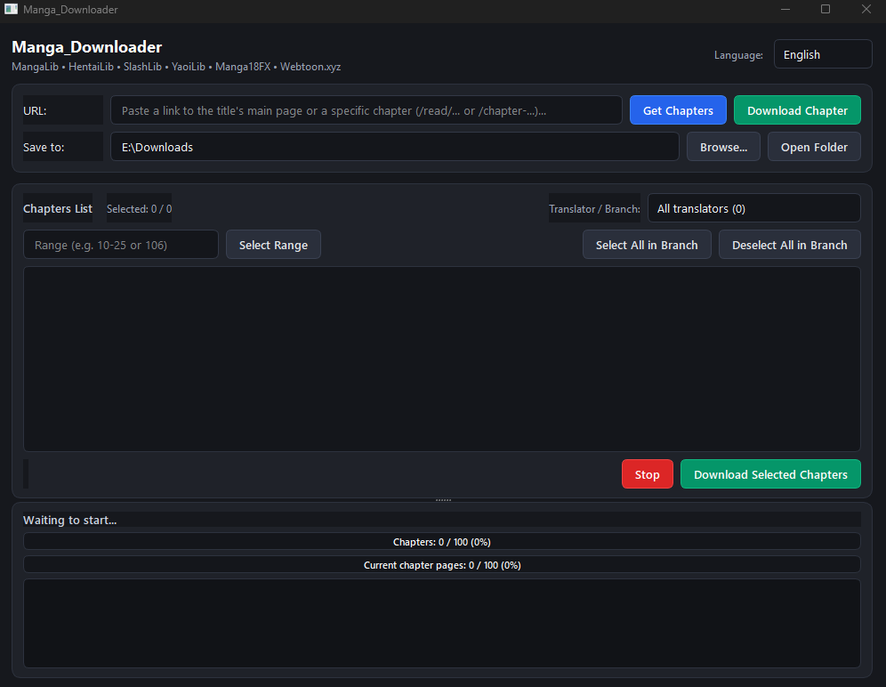
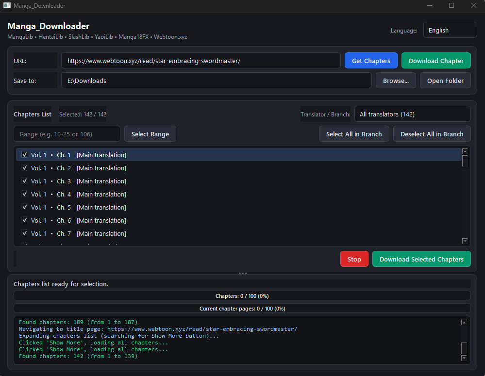
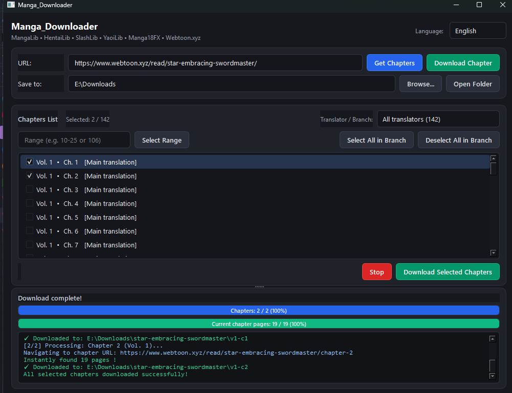
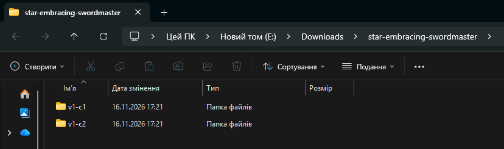

# Manga_Loder
A Python desktop application for quickly scanning and multithreaded downloading of manga, manhwa, and webtoons.(created primarily with the help of AI)
## Supported Websites

* **Homeland Lib.Social:** MangaLib, HentaiLib, SlashLib, YaoiLib
* **Other platforms:** Manga18FX, Webtoon.xyz

## Features

* **Support for translation branches (`.lib`):** automatic detection of all translator teams, filtering the list of chapters by translator, and automatic sorting of saved folders by team name.
*  For `.lib` — fetching pages via an internal JS API or fast atomic scrolling with parallel loading across 5 threads.
*  For `Manga18FX` and `Webtoon.xyz` — automatic expansion of the chapter list (`Show More`), instant page retrieval from the DOM without scrolling, and loading across 10 threads.
* **Convenient chapter selection:** load the entire title, select a range (e.g., `10-25` or `106`), or load a specific chapter directly via a link.
* **Multilingual interface:** Ukrainian, English, Russian (stored in `settings.json`).

## How to use 
* For .lib
  Select the desired title and go to the “Chapters” tab
  Copy the URL and paste it into the corresponding field in the program
  Select the desired chapters (or specify the desired range of chapters) and the translation command, then click “Download Selected Chapters” 
* For webtoon.xyz and manga18fx.com
  Select a title
  Copy the URL and paste it into the corresponding field in the program
  Select the chapters you want (or specify the range of chapters) and the translation command, then click “Download Selected Chapters”









## Project Structure

* `app_pyside.py` — graphical user interface and background browser control thread (`BrowserWorker`).
* `core.py` — logic for parsing chapters, handling age restrictions, managing sessions, and multithreaded image loading.
* `i18n.py` — translation dictionaries and language settings storage.
* `requirements.txt` — a list of libraries required to run the project from source code.

## Running the Pre-built Build (.exe)

1. Go to the **Releases** section of this repository and download the `.exe` file.
2. Make sure you have **Google Chrome** or **Microsoft Edge** installed on your PC (required for `DrissionPage` to work).
3. Run the `.exe` file. A `Downloads` folder and a `settings.json` configuration file will be created automatically next to the executable file.

## Running from Source Code and Building

### Installing Dependencies
```bash
pip install -r requirements.txt
